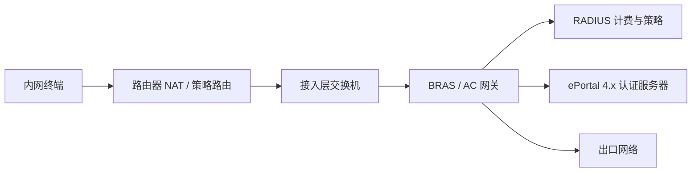
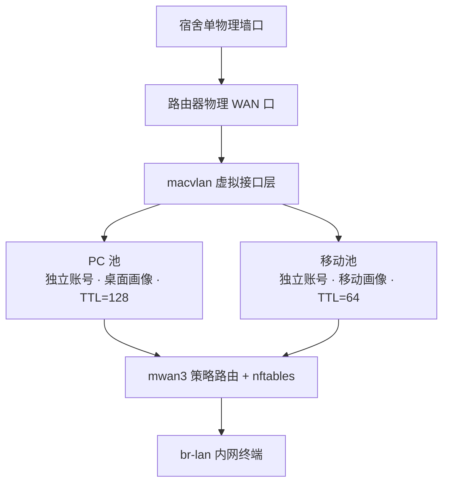
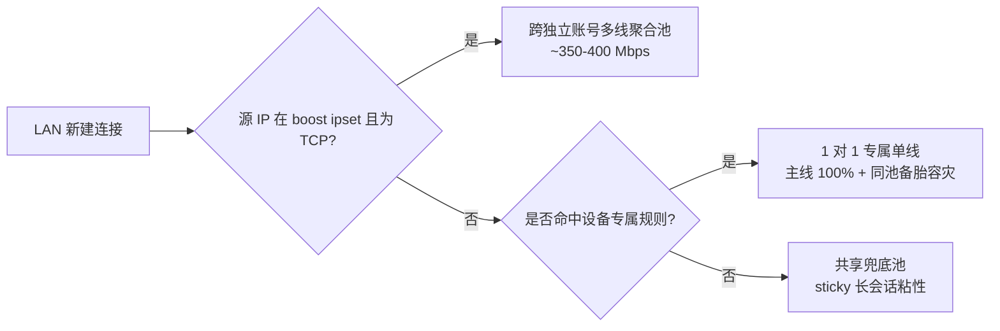

# 高校校园网多拨双池架构、协议栈特征与网络排障原理笔记

> **性质说明**：本文仅作为计算机网络、Linux 内核协议栈、OpenWrt/ImmortalWrt 策略路由与可观测性排障的**原理学习笔记**，**不提供任何可直接执行的认证脚本、绕过代码或敏感配置**。请严格遵守所在高校的网络管理规定，仅在自有/授权实验环境下研究学习。

测试参考环境：
- **硬件平台**：ARMv8 四核路由平台（IPQ807x / 1GB RAM）
- **系统内核**：ImmortalWrt 25.12（Linux 6.12 / `fw4` 原生 `nftables`）
- **网络背景**：Web 端 Dr.COM / ePortal 4.x 认证架构 + 单物理上联口多虚拟接口实验环境（PC + 移动端混合终端）

---

## 目录

- [0. 核心结论（先看这四句话）](#0-核心结论先看这四句话)
- [1. 校园网认证与多设备检测机制剖析](#1-校园网认证与多设备检测机制剖析)
- [2. 单线伪装 vs 多拨双池：两种架构的工程权衡](#2-单线伪装-vs-多拨双池两种架构的工程权衡)
- [3. 多虚拟 WAN 的底层原理与常见暗坑](#3-多虚拟-wan-的底层原理与常见暗坑)
- [4. 协议栈一致性与最容易被忽略的四个隐蔽缺口](#4-协议栈一致性与最容易被忽略的四个隐蔽缺口)
- [5. 性能瓶颈与偶发卡顿的内核级排障原理](#5-性能瓶颈与偶发卡顿的内核级排障原理)
- [6. 稳态隔离 + 按需弹性聚合的流量调度思路](#6-稳态隔离--按需弹性聚合的流量调度思路)
- [7. 可观测性与抓包排障方法论](#7-可观测性与抓包排障方法论)
- [8. 致谢与参考资料](#8-致谢与参考资料)

---

## 0. 核心结论（先看这四句话）

1. **多设备识别并非单一维度，而是“画像一致性”的综合评估**：链路层 MAC、网络层 TTL/IPv6、传输层 TCP 选项（时间戳 `TSval`、初始窗口、窗口缩放 `wscale`）、应用层明文 HTTP 头（`User-Agent` / `Referer` / `Accept-Language`）以及新建连接速率，只要在同一出口 IP 上出现明显自相矛盾，就可能触发网关风控（例如 Dr.COM 常见的 `146` 300 秒冷却）。
2. **路由器自身的 `OUTPUT` 流量是最隐蔽的“自曝源”**：大多数规则只挂在局域网转发链（`FORWARD` / `PREROUTING`），而路由器本机的 DNS 查询、探活脚本、透明代理回流连接走的是 `OUTPUT`。如果本机 Linux 内核开着 `tcp_timestamps=1`，或者把不同系统（iOS + Windows）的直连流量经本机代理重发到同一条 PC 出口，该出口会成为最容易触发异常的靶子。
3. **物理分池隔离（1 对 1）往往优于单线重型中转**：单 WAN 场景下多台终端被迫共享 1 个公网/内网出口 IP，只能靠全量 TCP 终结重发起（如 Squid splice / TPROXY 中转）+ 封杀 QUIC 强行抹平指纹；而在具备多逻辑通道的实验架构中，按终端类型（桌面池 / 移动池）与设备维度隔离出口，天然保持协议栈原生自洽，且对视频/游戏延迟零损耗。
4. **“网络偶发小卡顿”八成不是带宽不够，而是细节配置失衡**：DoT（853 端口）静默 `drop` 导致的 1–3 秒 TCP SYN 超时、单核软中断（RPS）失衡导致的 `softnet_stat` 队列丢包、DNS 通配符 `*.` 与 `+.` 混用造成的多级子域错误分流、`NFQUEUE` 规则未加掩码误拦回包 `SYN+ACK`，每一个都会直接转化为体感卡顿。

---

## 1. 校园网认证与多设备检测机制剖析

### 1.1 Dr.COM ePortal 4.x 认证链路模型

典型的高校有线校园网接入链路如下：

在 NAT 架构下，BRAS 与认证服务器只能看到路由器上联口的 IP 与 MAC，但网关仍会通过以下机制判断该出口后方是否存在多终端混杂：

| 维度 | 检测原理 | 典型暴露场景 |
|---|---|---|
| **前端自报 NAT** | 门户页面 JS 主动探测私网段、调用 WebRTC ICE 获取本地地址并加密上报 | 内网终端直接打开认证页，上报私网网关与设备类型 |
| **终端类型画像（`mac_type`）** | 认证阶段按请求参数与 UA 标记桌面端 / 移动端，并与后续业务流量对照 | 认证为 PC 终端，业务流量却持续出现移动系统特征或相反 |
| **IPv4 TTL / IPv6 裸奔** | 路由器转发使 TTL 减 1（如 128→127、64→63）；IPv6 无 NAT 会直接暴露各终端独立地址与 MAC | 未做出口 TTL 归一化，或未禁用公网 IPv6 / AAAA 解析 |
| **明文 HTTP 头混杂** | 同一出口 IP 上同时出现多种操作系统的 `User-Agent`、`Referer`、`Accept-Language` | 多台不同型号设备共享同一出口并产生明文 HTTP（80 等端口）流量 |
| **TCP 协议栈指纹** | Windows 默认不发 TCP 时间戳（`noTS`），Android / iOS / Linux 默认带 `TSval`，且初始窗口与 `wscale` 各异 | 同一出口下同时存在带 TS 与不带 TS 的新建 TCP SYN |
| **DNS / NTP / 广播侧信道** | SSDP(1900)、mDNS(5353)、LLMNR(5355)、WS-Discovery(3702)、NetBIOS(137-139/445)、DoT(853) 与外部 NTP(123) 泄漏 | 局域网发现协议穿出 WAN，或多设备直连不同外部 DNS/NTP |
| **新建连接速率与并发数** | 监控单 IP 每秒新建 SYN 速率及活跃流数量 | 突发测速、P2P/BT、或单线挂过多重度设备冲破阈值触发 `146` 冷却 |

### 1.2 认证协议与状态观测要点

在学习 ePortal 4.x 协议交互时，有几个工程上容易混淆的机制：

- **两阶段校验**：登录前通常先经过 `custom/checkLogin` 校验账号绑定状态，再进入 `login` 正式认证；部分账号对预检字段（如 `phone_flag`）有特定校验要求，若不匹配会返回 TOTP 校验提示而非密码错误。
- **区分三种响应**：
  - 正常外网响应（含源站 `Server` / `Date` 头或预期状态码如 `204`）；
  - BRAS 透明注入劫持页（通常为定长裸 HTML `location.href` 跳转，源 IP 仍是目标网站，极易被误判为 `HTTP 200` 在线）；
  - `146` 冷却态（固定时长如 300 秒封停，期间高频重试无意义，必须遵循静默冷却窗口）。
- **只读会话对账**：Portal 的只读会话查询接口与自服务平台可直观反映网关侧记录的在线时长、终端类型与 IPv6 状态，适合作为排查掉线原因与画像是否一致的客观依据。

---

## 2. 单线伪装 vs 多拨双池：两种架构的工程权衡

在开源社区中，针对单条校园网线路的经典做法是**“单 WAN + 全量 TCP 终结重发起（如 Squid `ssl_bump splice all` 或 TPROXY 中转）+ 全量 HTTP 头改写 + 封杀 QUIC”**。这套方案在只有 1 个出口 IP 时非常扎实，但代价是所有流量需经用户态转发、视频首帧略慢，且单账号仍受限于单线带宽上限（通常 ~100 Mbps）。

在多账号/多虚拟 WAN 条件下，**双池架构**提供了另一种截然不同的工程思路：

| 对比维度 | 单线重型伪装架构 | 多拨双池分流架构 |
|---|---|---|
| **隔离层级** | 逻辑层（多台设备共用 1 个 IP，靠代理/中转抹平差异） | **出口层（按 OS 分池，主力设备 1 对 1 独享出口）** |
| **带宽上限** | 单账号限速桶（约 100 Mbps） | **跨独立账号线性叠加**（注意：同账号多 MAC 共享同一个限速桶，不叠加带宽） |
| **内核转发开销** | 全部 TCP（含 443）走用户态重发起 | 直连流量保持纯内核快路径，仅必要环节做轻量规则处理 |
| **QUIC / 视频体验** | 通常需封杀 UDP 443/80 | 独享线路无需强杀国内 QUIC，短视频/直播首帧无损 |
| **主要约束** | 对低性能路由器 CPU 压力大 | 需注意接入交换机单端口 MAC 数量上限，以及各通道凭据与画像维护 |

---

## 3. 多虚拟 WAN 的底层原理与常见暗坑

在单物理网口上通过 `macvlan` 派生多个虚拟 WAN（`vwan1..N`）并配合 `mwan3` 实现策略路由，内核层有 4 个必踩的底层知识点：

1. **同网段多接口 ARP 串台与非对称路由**：
   - 所有 `vwan` 处于同一校园网二层子网（共享同一网关）。Linux 默认的弱主机模型会导致内核从错误接口响应 ARP，或因反向路径校验（`rp_filter`）丢弃回包。
   - **原理对策**：必须配置 `arp_ignore=1`、`arp_announce=2`、`arp_filter=0`、`rp_filter=0`，确保每个虚拟口严格只认自己的 IP/MAC 与策略路由表。
2. **DHCP 客户端 RFC 4361 DUID 冲突**：
   - 较新的 OpenWrt / ImmortalWrt 25.x 默认会生成全局 `dhcp_default_duid`，导致多个 `macvlan` 向同一台 DHCP 服务器发送相同的 Client-ID，引发服务器拒发地址或互相顶掉租约。清除全局默认 DUID 后各接口才能独立拿到稳定 IP。
3. **本机 `OUTPUT` 路由标记冲突**：
   - 路由器本机发起的探测或认证流量如果不绑定指定 `mwan3` 策略表与 `fwmark`，会随机或始终落到 `metric` 最小的默认路由口，导致“以为在测线路 B，实际包从线路 A 发出”的假阴性/假阳性。
4. **硬件加速（Flow Offloading）与逐包规则互斥**：
   - 开启内核流分载后，一条连接只有前几个报文经过 `netfilter`，后续报文直接绕过防火墙链。对于依赖 `POSTROUTING` 逐包改写 TTL 或 NFQUEUE 检查的规则，开启 Offloading 会导致同一条流前半段 TTL 为 128、后半段突然跳回原始值，反而制造出最明显的异常特征。

---

## 4. 协议栈一致性与最容易被忽略的四个隐蔽缺口

### 4.1 路由器自身 `OUTPUT` 成为“混杂重灾区”

在具备透明代理（如 Fake-IP 分流）的路由器上，极易出现一个隐蔽连锁反应：

1. 内网手机（iOS）与电脑（Windows）访问某些本应直连的国际大厂服务（如苹果推送 APNs、微软 WNS/Edge/Office），若这些域名未列入 Fake-IP 白名单，会被分配假 IP 并被劫持进路由器本地透明代理端口；
2. 代理匹配到 `DIRECT` 规则后，**由路由器自己的 Linux 协议栈重新对外建连**，全部汇总到路由器本机出口；
3. 结果：这一条认证为“Windows PC”的线路上，同时出现了 **Linux 内核 TCP 时间戳（`net.ipv4.tcp_timestamps=1`）+ iPhone 苹果推送 + Windows 微软服务 + 全内网 DNS 上游查询**。

**原理修法**：
- 路由器内核直接关闭 `net.ipv4.tcp_timestamps = 0`，让本机出向 TCP 天然不携带 Linux 时间戳；
- 将规则中本就 `DIRECT` 的苹果/微软基础直连域名精确放行出 Fake-IP（避开仍需代理的开发者/AI 域名），让手机流量回手机口、电脑流量回电脑口，彻底给路由器本机出口“去混杂”。

### 4.2 `nftables` 中 `tcp flags syn` 漏写掩码的副作用

在 `nftables` 中：
- `tcp flags syn`（无掩码）匹配的是**任何置位了 SYN 比特的包**，既包含出向新建连接的 `SYN`，也包含服务端返回的 **`SYN+ACK`**；
- 正确匹配纯出向建连的写法是 `tcp flags & (fin | syn | rst | ack) == syn`，并明确限定 `oifname` 为 WAN 接口集合。
- 若未限定出口与掩码，LAN 内网互访、本机回环（`lo`）以及服务端返回的 `SYN+ACK` 全都会被拉入用户态 NFQUEUE 队列，白白增加握手抖动甚至破坏回包选项。

### 4.3 `fake-ip-filter` 通配符 `*.` 与 `+.` 的级数差异

在常见代理核心的域名匹配语法中：
- `*.example.com` **仅匹配单级子域名**（如 `www.example.com`），**不匹配根域和多级子域**（如 `a.b.example.com`）；
- `+.example.com` 才同时匹配根域及任意层级子域名。

一旦国内高频 App（短视频、AI 客户端、即时通讯）的多级子域名因 `*.` 漏匹配而落入 Fake-IP，其 UDP/QUIC 请求会被拦截，TCP 长连接则会绕经代理甚至误入海外节点，直接表现为“刷视频转圈”或“桌面客户端消息发不出去”。

### 4.4 DNS（53）与 NTP（123）透明接管

仅拦截 DoT（853 端口）并不足以闭环：部分手机或 App 会硬编码外部 `53` 端口 DNS 或自带 NTP 服务器。在 `nat prerouting` 将 `br-lan` 发往非路由器地址的 `TCP/UDP 53` 与 `UDP 123` 透明重定向到路由器本地 `dnsmasq` 与 `ntpd`，才能真正收拢所有解析与校时流量。

---

## 5. 性能瓶颈与偶发卡顿的内核级排障原理

在多拨且关闭 Flow Offloading 的软路由上，体感“偶尔小卡一下”通常来自以下三处内核与防火墙细节：

### 5.1 DoT（853）用 `drop` 还是 `reject`？

- **静默 `drop`**：手机系统/App 尝试连加密 DNS（TCP 853）时收不到任何响应，只能等待 TCP SYN 超时重传（**1 秒 → 3 秒**）后才回退本地 53 端口，体感就是“点开 App 先白屏卡 2–3 秒”。
- **快速 `reject`**：改为 `tcp dport 853 reject with tcp reset` 与 `udp dport 853 reject with icmp type port-unreachable` 后，客户端在 **<1 ms** 内立即感知端口不可达并无缝回退 53 端口，反检测效果完全相同，卡顿瞬间消失。

### 5.2 多核 RPS / RFS 与 `/proc/net/softnet_stat` 软中断丢包

排查软路由莫名丢包时，不能只看平均 CPU 负载（`loadavg` 低不代表单核没满），必须核对三项指标：
1. `/proc/interrupts`：观察网卡硬件中断（如 `edma_rxdesc` / `edma_txcmpl`）绑在哪个 CPU 核上；
2. `/sys/class/net/<dev>/queues/rx-*/rps_cpus`：检查软中断分发掩码是否把所有 RX 队列都塞给了同一个核心；
3. `/proc/net/softnet_stat` 第 2 列（十六进制）：即内核因 `netdev_max_backlog` 满载而丢弃的数据包计数。

**调优原理**：将硬件中断所在核心（如 CPU3）留给硬中断，将 `wan` 与 `br-lan` 的 `rps_cpus` 掩码设为其余核心（如 `7` = CPU0/1/2），同时启用 RFS（`rps_sock_flow_entries` 与 `rps_flow_cnt`，保证同一 TCP 流落同一核心不乱序），并适度放大 `net.core.netdev_max_backlog` 与 `net.core.netdev_budget`，即可将软中断突发丢包压到 0。

### 5.3 定时任务错峰与抓包混杂模式抖动

- 多个监控/保活 cron 若全部写在 `*/5` 整点，会在同一秒争抢 CPU 与锁资源；错开分钟偏移（如 `:01/:03/:07`）即可消除周期性尖峰。
- 定时 `tcpdump` 采样若不加 `-p`（`--no-promiscuous-mode`），会导致网桥 `br-lan` 周期性进出混杂模式。对于路由转发场景，加 `-p` 同样能抓到完整的出向流。

---

## 6. 稳态隔离 + 按需弹性聚合的流量调度思路

“防检测稳态（单设备锁定单线）”与“高速下载（多账号聚合）”看似矛盾，实际上可以通过 **`mwan3` 规则优先级 + `ipset` 热插拔** 解耦：

- **平时（99% 时间）**：所有常驻 PC 与主力手机各自锁定专属单线，互不干扰、零撞线、不触发任何 reload；
- **大文件/游戏更新触发**：守护进程每秒读取对应虚拟口 `/sys/class/net/vwanX/statistics/rx_bytes`（纯内存计数器，极低开销），连续数秒达到单线阈值（如 ≥75–80 Mbps）后，仅将该设备的 **TCP** 流量通过 `ipset add ... timeout` 热写入多账号聚合池；
- **UDP 零抖动**：游戏、语音等 UDP 流量不匹配该 TCP-only 加速规则，始终死锁在专属单线上；
- **自动回落**：下载结束后 `ipset` 条目自动超时过期，无缝退回 1 对 1 稳态，全程**无需重载 `mwan3`**。

---

## 7. 可观测性与抓包排障方法论

在做校园网与多拨排障时，**观测口径错误比没有观测更危险**，以下 4 条经验最关键：

1. **严格区分 `br-lan`（入口）与物理 `wan`（出口）视角**：
   - 在 `br-lan` 抓到的是终端原始报文（TTL 未改、UA 未改、DoT 未拦）；
   - 在物理 `wan` 口抓到的才是真正发往校园网的最终报文；
   - Linux `macvlan` 子接口 `tcpdump -i vwanN` 在某些内核/驱动下抓不到完整转发流量，应抓物理父口 `wan` 并用 `ether src <MAC>` 按接口精确过滤，避免把多条线路的包混在一起误判。
2. **监控不要遗漏路由器本机流量**：
   - 仅统计 `192.168.1.x` 的 `conntrack` 会让路由器本机出口（源地址为 WAN 网段）完全隐身，必须单独归类统计。
3. **建立“断线黑匣子”机制**：
   - 靠 5 分钟定时任务发现掉线时，案发现场的连接早已超时消失。应将快照脚本直接挂在 `mwan3` 的 `disconnected` 事件钩子（约 25 秒内触发）与认证异常分支上，在掉线瞬间保存该接口 `conntrack`、代理活跃连接、`nft` 计数与内核丢包状态，事后复盘才能一击命中根因。
4. **注意记账工具的本地网段范围**：
   - 若校园网 WAN 分配的本身是 `172.16.0.0/12` 私有地址，像 `nlbwmon` 这类按“内网 ↔ 非内网”记账的工具，若默认配置把 `172.16.0.0/12` 也当成了 `local_network`，会导致所有流量被判定为“内网互访”而写出空库。

---

## 8. 致谢与参考资料

本文的架构梳理与多项实证思路深受以下开源社区项目启发，在此致谢：

- **[YifanHere/campus-net-nat-bypass](https://github.com/YifanHere/campus-net-nat-bypass)**：对 Dr.COM / ePortal 4.x 认证协议、门户前端自报 NAT、路由器本机 `OUTPUT` 暴露面、HTTP 附属请求头以及新建连接速率阈值的深入实证剖析。
- **[Doublesail-A/fafu-campus-net-pass](https://github.com/Doublesail-A/fafu-campus-net-pass)**：对 `nftables` + `Squid splice` 端到端 TLS 透传重建 TCP、多路径延迟基准监测的工程实践。
- **OpenWrt / ImmortalWrt、`mwan3`、`UA2F`、`UA3F`** 等开源网络项目社区。

---

## 开源协议与免责声明

- 本文档采用 **MIT / Apache-2.0** 学习交流原则，欢迎参考网络架构、Linux 内核调优与排障方法论。
- 本文不包含任何学校具体敏感凭据、真实设备标识或自动化绕过脚本；读者在进行任何网络实验前，请确保已获得网络管理方许可并遵守相关规章制度。
